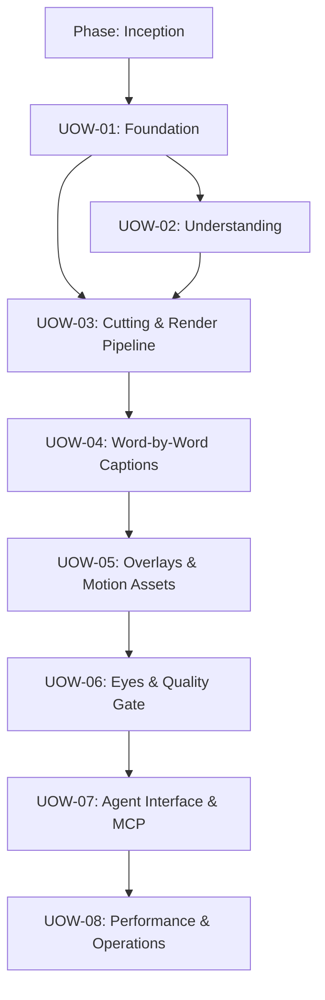

# Cutline - Units of Work & Implementation Plan (AI-DLC Construction)

This document outlines the breakdown of the **Construction** and **Operations** phases into 8 focused **Units of Work (UOW)**. Each unit adheres to the SDD flow: **spec slice -> plan -> tasks -> implementation -> verification -> demo**.

---

## Dependency Graph



---

## Unit 1: Foundation (Workspace, Core Data Types, FFmpeg Probing & Audio Extract)
- **Goal**: Establish the Cargo workspace, create core data types (`FrameTime`, `Fps`, `Project`, `Timeline`), implement FFmpeg detection, media probing, 16kHz mono audio extraction, and project schema serialization.
- **Requirement IDs Covered**: `REQ-CORE-001`, `REQ-CORE-002`, `REQ-CORE-003`, `REQ-MEDIA-001`, `REQ-MEDIA-002`, `REQ-MEDIA-003`, `REQ-AGENT-001`, `REQ-AGENT-002`, `REQ-AGENT-003`.
- **Key Tasks**:
  1. Configure `Cargo.toml` workspace and crates: `cutline-core`, `cutline-media`, `cutline-cli`.
  2. Implement rational time types with unit tests.
  3. Implement FFmpeg path discovery, version checks, and structured error on missing FFmpeg.
  4. Implement `cutline probe <video>` extracting resolution, fps, duration, and codecs to JSON.
  5. Implement `cutline project init <video>` creating a valid `project.json` matching JSON schema.
  6. Implement `cutline audio extract <video>` converting audio to 16kHz mono PCM WAV.
  7. Implement CLI output JSON envelope and stderr logging.
- **Verification**:
  - `cargo test -p cutline-core -p cutline-media`
  - Integration test probing a sample video.
- **Demo Command**:
  ```powershell
  cargo run -p cutline-cli -- probe sample.mp4
  cargo run -p cutline-cli -- project init sample.mp4 --out project.json
  cargo run -p cutline-cli -- audio extract project.json --out audio_16k.wav
  ```

---

## Unit 2: Understanding (Local Whisper STT & Audio Analysis)
- **Goal**: Integrate `whisper-rs` for offline speech transcription with word-level timestamps, and build energy-based silence detection with hysteresis.
- **Requirement IDs Covered**: `REQ-STT-001`, `REQ-STT-002`, `REQ-STT-003`, `REQ-ANALYSIS-001`, `REQ-ANALYSIS-002`.
- **Key Tasks**:
  1. Implement model download manager to cache `ggml-base.bin` in user local cache dir.
  2. Implement `cutline-stt` transcription pipeline with token-level timestamp extraction.
  3. Normalize tokens into word-level records (`word`, `start_frame`, `end_frame`, `confidence`).
  4. Implement `cutline-analysis` RMS energy calculator with dual-threshold hysteresis silence detector.
  5. Implement `cutline transcribe` and `cutline analyze silence` CLI commands.
  6. Implement optional scene detection (`cutline analyze scenes`).
- **Verification**:
  - Unit tests on synthetic PCM audio containing known silence gaps.
  - Integration test transcribing a short spoken test clip.
- **Demo Command**:
  ```powershell
  cargo run -p cutline-cli -- transcribe project.json --out transcript.json
  cargo run -p cutline-cli -- analyze silence project.json
  ```

---

## Unit 3: Cutting & Frame-Accurate Render Pipeline
- **Goal**: Implement non-destructive timeline editing operations (`cut`, `trim`, `auto-cut-silence`) and the high-speed streaming render pipeline (FFmpeg rawvideo decode -> multi-threaded frame pass-through -> FFmpeg encode + audio muxing) with strict A/V sync.
- **Requirement IDs Covered**: `REQ-EDIT-001`, `REQ-EDIT-002`, `REQ-EDIT-003`, `REQ-RENDER-001`, `REQ-RENDER-002`, `REQ-RENDER-003`, `REQ-RENDER-004`.
- **Key Tasks**:
  1. Implement timeline edit operations (`cut`, `trim`, `keep`) in `cutline-core`.
  2. Implement `cutline timeline auto-cut-silence` applying 50ms padding.
  3. Implement clock remapping logic for transcript words when cuts are applied.
  4. Build bounded producer-consumer render pipeline using `crossbeam-channel` and pre-allocated buffer pool.
  5. Stream cut audio slices from source and mux into output container via FFmpeg.
  6. Implement hardware encoder detection and fallback cascade.
- **Verification**:
  - Unit test verifying sample-exact A/V synchronization across multiple cut points.
  - Verification that memory usage remains flat during render.
- **Demo Command**:
  ```powershell
  cargo run -p cutline-cli -- timeline auto-cut-silence project.json
  cargo run -p cutline-cli -- render project.json --out cut_draft.mp4 --preset fast-draft
  ```

---

## Unit 4: Word-by-Word Kinetic Captions
- **Goal**: Implement native pure-Rust text rasterization (`fontdue` + `tiny-skia`), smart word grouping (2-4 words), platform safe-area layout, and the `clean-yellow` active-word pop animation.
- **Requirement IDs Covered**: `REQ-CAP-001`, `REQ-CAP-002`, `REQ-CAP-003`, `REQ-CAP-004`.
- **Key Tasks**:
  1. Bundle open-license font files (Inter Bold) in binary.
  2. Implement caption grouping algorithm (2-4 words, punctuation breaks, min 400ms duration).
  3. Implement glyph layout, word bounding boxes, and safe-area positioning.
  4. Implement `clean-yellow` style: `#FFFFFF` inactive words, `#FFD60A` active word, 4px dark outline, subtle drop shadow.
  5. Implement word pop scale animation ($1.0 \rightarrow 1.15 \rightarrow 1.0$) with `EaseOutBack`.
  6. Connect captions renderer into the Rayon compositing pipeline.
- **Verification**:
  - Golden image test verifying rendered caption frame matching reference bitmap.
  - Word grouping unit tests.
- **Demo Command**:
  ```powershell
  cargo run -p cutline-cli -- captions apply project.json --style clean-yellow
  cargo run -p cutline-cli -- render project.json --out captioned.mp4
  ```

---

## Unit 5: Overlays & Motion Assets
- **Goal**: Build the vector asset system, procedural motion templates (lower thirds, badges, progress bar, punch-in zoom), animated SVG rendering with `resvg`, and register the proof animated flying bird asset.
- **Requirement IDs Covered**: `REQ-OVERLAY-001`, `REQ-OVERLAY-002`, `REQ-OVERLAY-003`, `REQ-OVERLAY-004`.
- **Key Tasks**:
  1. Implement procedural templates: `lower-third`, `keyword-badge`, `animated-progress`, `punch-in-zoom`.
  2. Implement SVG keyframe interpolation (translation, scale, opacity) rendered via `resvg`.
  3. Author and bundle the animated flying bird proof asset (`assets/bird.svg`).
  4. Implement secondary B-roll video cutaway track compositing.
  5. Implement `cutline overlay add` and `cutline assets list / add`.
- **Verification**:
  - Unit test rendering templates across keyframe intervals.
  - Golden image comparison of SVG overlay frame.
- **Demo Command**:
  ```powershell
  cargo run -p cutline-cli -- assets list
  cargo run -p cutline-cli -- overlay add project.json --asset bird_flying --at 00:00:04.000 --duration 00:00:03.000 --anchor top_center
  cargo run -p cutline-cli -- render project.json --out animated.mp4
  ```

---

## Unit 6: Eyes & Quality Gate (`preview` & `lint`)
- **Goal**: Enable visual inspection for the AI agent via `preview-frame` and `preview-strip`, and build the `cutline lint` rule validation engine.
- **Requirement IDs Covered**: `REQ-PREVIEW-001`, `REQ-PREVIEW-002`, `REQ-LINT-001`.
- **Key Tasks**:
  1. Implement `cutline preview-frame --time <time> --out <frame.png>` rendering full composite to PNG.
  2. Implement `cutline preview-strip --count 8 --out-dir <dir>` generating thumbnail contact sheet.
  3. Build `cutline-lint` engine checking rules `LINT-001` through `LINT-008` (safe area, collisions, word-cut splits, palette compliance).
- **Verification**:
  - Unit tests for each linter rule (validating violation detection on malformed projects).
  - Integration test generating preview strip.
- **Demo Command**:
  ```powershell
  cargo run -p cutline-cli -- preview-frame project.json --time 00:00:05.500 --out frame.png
  cargo run -p cutline-cli -- preview-strip project.json --count 6 --out-dir previews/
  cargo run -p cutline-cli -- lint project.json
  ```

---

## Unit 7: Agent Interface & MCP Server
- **Goal**: Implement `cutline mcp` (stdio Model Context Protocol server) exposing all tools to Antigravity IDE, verify pure JSON stdout and stderr log separation, and execute the complete autonomous agent workflow.
- **Requirement IDs Covered**: `REQ-AGENT-001`, `REQ-AGENT-002`, `REQ-AGENT-003`, `REQ-AGENT-004`.
- **Key Tasks**:
  1. Implement stdio JSON-RPC 2.0 MCP server registering all 14 Cutline tools.
  2. Ensure strict JSON formatting on stdout and redirection of all logs to stderr.
  3. Validate structured error responses with recovery hints.
  4. Run an autonomous end-to-end integration test where an agent script executes the entire talking-head workflow.
- **Verification**:
  - Automated test verifying MCP handshake, tool listing, and tool execution.
  - End-to-end sample test.
- **Demo Command**:
  ```powershell
  cargo run -p cutline-cli -- mcp
  ```

---

## Unit 8: Performance, Operations & Release
- **Goal**: Criterion benchmarks, hardware encoding optimization (>= 2x realtime), memory leak profiling, release packaging, `AGENTS.md` operating manual, and `docs/agent-playbook.md`.
- **Requirement IDs Covered**: `REQ-NFR-001`, `REQ-NFR-002`, `REQ-NFR-003`, `REQ-NFR-004`.
- **Key Tasks**:
  1. Add Criterion benchmarks for frame compositing and text rasterization.
  2. Measure and report render speed ($x$-realtime) across presets.
  3. Verify flat memory consumption under prolonged rendering.
  4. Write `AGENTS.md` and `docs/agent-playbook.md`.
  5. Ensure zero clippy warnings (`cargo clippy -- -D warnings`) and formatted code (`cargo fmt`).
- **Verification**:
  - `cargo bench`
  - `cargo clippy --workspace --all-targets -- -D warnings`
  - Full demo run on target talking-head video.
