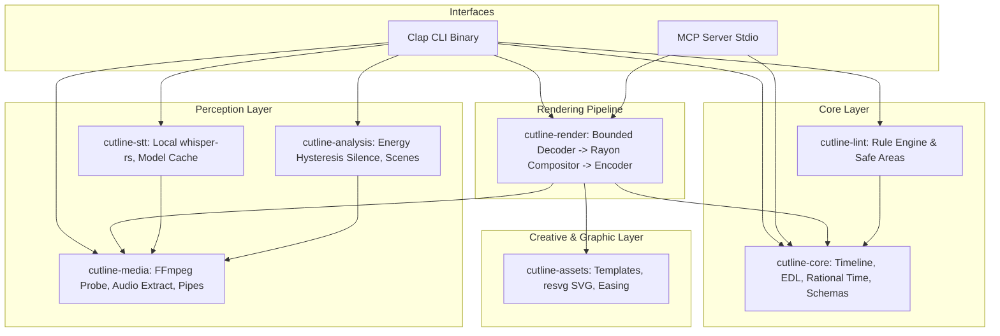
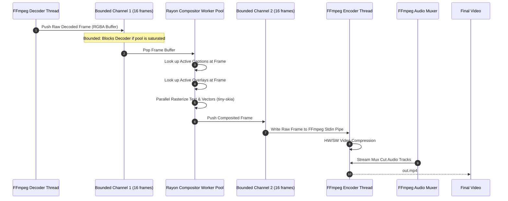
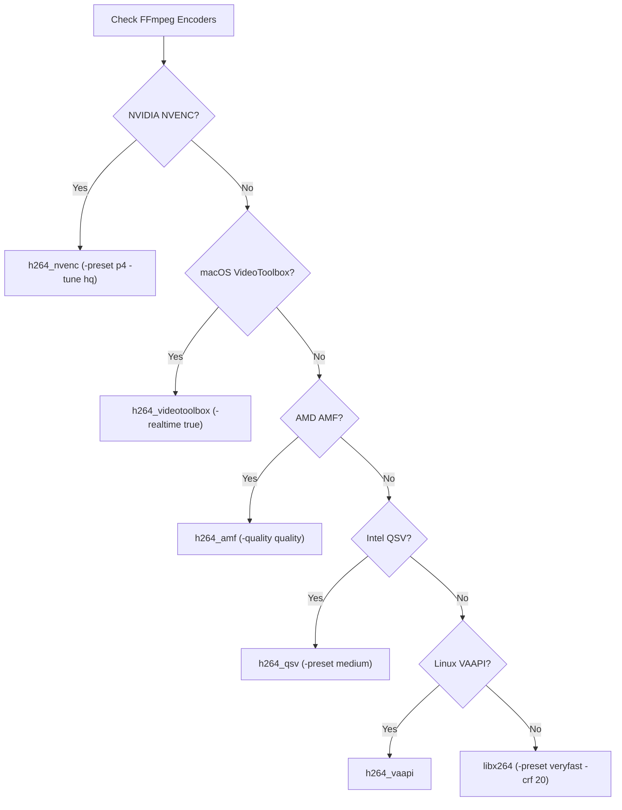

# Cutline - Architecture & System Design Specification

This document details the software architecture, crate boundaries, data flow pipelines, threading models, and hardware acceleration strategies for **Cutline**.

---

## 1. High-Level System Architecture

Cutline is built as a modular Rust Cargo workspace designed for high throughput, low memory footprint, and seamless control by AI agents.



---

## 2. Workspace Crate Decomposition

| Crate | Responsibility | Key Dependencies |
|---|---|---|
| `cutline-core` | Data structures for `Project`, `Timeline`, `Segment`, `Track`, `CaptionSegment`, `OverlayItem`. Rational frame-accurate time (`FrameTime`, `Fps`). Schema generation (`schemars`). | `serde`, `serde_json`, `schemars`, `thiserror` |
| `cutline-media` | Child process FFmpeg management, JSON probe parsing, 16kHz mono audio extraction, streaming pipes (`rawvideo` RGB24/RGBA, `s16le` PCM audio), hardware encoder capability probing. | `serde`, `serde_json`, `tracing`, `which`, `thiserror` |
| `cutline-stt` | Offline transcription using `whisper-rs` (whisper.cpp), model caching in user directory, token/word alignment, word probability scoring. | `whisper-rs`, `hound` (WAV parsing), `ureq` (cache download), `sha2` |
| `cutline-analysis` | DSP algorithms for RMS energy calculation, adaptive noise floor estimation, dual-threshold hysteresis silence detection, and scene boundary analysis. | `hound`, `rayon`, `thiserror` |
| `cutline-assets` | Built-in procedural vector motion templates, SVG animation rendering via `resvg`/`usvg`, asset metadata registry, easing curve math. | `resvg`, `usvg`, `tiny-skia`, `serde` |
| `cutline-lint` | Quality assurance engine checking safe areas, text legibility, collision between overlays and captions, pacing, and color palette constraints. | `cutline-core`, `serde`, `thiserror` |
| `cutline-render` | Bounded multi-threaded pipeline: FFmpeg decode stream -> Rayon frame compositor (text + vector overlays) -> FFmpeg encode stream + audio muxer. | `tiny-skia`, `fontdue`, `crossbeam-channel`, `rayon`, `cutline-media` |
| `cutline-cli` | Clap CLI command parsing, structured JSON formatting, error mapping, and MCP stdio JSON-RPC server. | `clap`, `serde_json`, `tracing-subscriber`, all workspace crates |

---

## 3. Streaming Render Pipeline & Threading Model

To ensure **flat memory usage regardless of video length** (< 350 MB RAM for 4K/1080p), the rendering engine employs a producer-consumer bounded pipeline with backpressure.



### Buffer Pooling & Zero-Copy Optimization
- Each 1080x1920 RGBA frame is `1080 * 1920 * 4 = 8,294,400 bytes` (~8.3 MB).
- The pipeline allocates a fixed pool of **32 pre-allocated frame buffers** (~265 MB total buffer memory).
- Buffers cycle through Decoder -> Compositor -> Encoder -> Recycle back to Decoder.
- Zero heap allocations occur in the hot per-frame render loop.

---

## 4. Time, Clock & Audio-Video Synchronization

### Rational Frame Clock
Edits and cuts cannot rely on floating-point seconds due to non-associative IEEE 754 rounding.
Cutline defines:

```rust
#[derive(Debug, Clone, Copy, PartialEq, Eq, PartialOrd, Ord, Hash, Serialize, Deserialize)]
pub struct Fps {
    pub num: u32,
    pub den: u32,
}

#[derive(Debug, Clone, Copy, PartialEq, Eq, PartialOrd, Ord, Hash, Serialize, Deserialize)]
pub struct FrameTime {
    pub frame: i64,
    pub fps: Fps,
}
```

- A cut from frame `F_start` to `F_end` precisely specifies the inclusive frame range.
- Audio is extracted at 48,000 Hz for final render.
- Audio sample count corresponding to frame `F` is computed as:
  $$\text{Sample}(F) = \left\lfloor \frac{F \times \text{sample\_rate} \times \text{fps.den}}{\text{fps.num}} \right\rfloor$$
- Audio cutting extracts contiguous PCM sample slices matching the exact frame boundaries.

---

## 5. Hardware Encoder Strategy & Fallback Cascade

Cutline probes the host system to determine available FFmpeg encoders at runtime.



The selected encoder is validated by running a 1-frame test encoding to a null sink. If the hardware device fails (e.g. driver limitation), it gracefully falls back to `libx264`.

---

## 6. Text & Vector Rendering Engine

### Text Pipeline
1. **Font Loading**: High-quality open-license variable fonts (Inter Bold, Montserrat ExtraBold) are bundled in the binary via `include_bytes!`.
2. **Text Shaping & Rasterization**: Pure Rust `fontdue` rasterizes font glyphs into alpha masks with 8-bit sub-pixel coverage.
3. **Compositing**: `tiny-skia` draws glyphs with:
   - Drop shadow / Gaussian blur.
   - 4px stroke outline for contrast over varying background scenes.
   - Foreground fill: White (`#FFFFFF`) for inactive words, Warm Yellow (`#FFD60A`) for the active word.
   - Subtle scale transform (1.10x pop) centered on the active word.

### Overlay & Vector Pipeline
- Procedural templates (lower-thirds, badges, counters) are drawn directly with `tiny-skia` primitives (paths, rounded rects, linear gradients).
- SVG assets are parsed using `usvg` and rasterized with `resvg` directly into a temporary `tiny-skia` pixmap, then blended onto the master frame with alpha compositing (`tiny-skia::BlendMode::SourceOver`).
