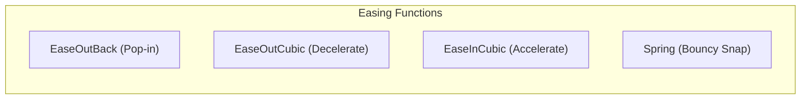

# Cutline - Visual Design System & Quality Guidelines

This document specifies the typography, safe areas, color palettes, motion easing curves, procedural motion templates, and automated linter rules enforced by Cutline.

---

## 1. Canvas Dimensions & Platform Safe Areas

Short-form platforms (TikTok, Instagram Reels, YouTube Shorts) overlay essential UI elements (top search/tabs, bottom captions/sound metadata, right-hand interaction icons). Visual content and captions must strictly respect these boundaries.

```
+-------------------------------------------------------+ (0,0)
|                 TOP MARGIN: 200px                     |
|           (Search bar, Following/For You tabs)        |
+-------------------------------------------------------+
|  L                                                 R  |
|  E                                                 I  |
|  F                                                 G  |
|  T                                                 H  |
|                                                    T  |
|  9                                                    |
|  0                    SAFE ZONE                    1  |
|  p                                                 3  |
|  x           (Captions, Overlays, Subject)         0  |
|                                                    p  |
|                                                    x  |
|                                                       |
|                                                (Icons)|
+-------------------------------------------------------+
|                BOTTOM MARGIN: 380px                   |
|        (Username, caption text, sound track banner)   |
+-------------------------------------------------------+ (1080, 1920)
```

### Safe Area Geometry (1080x1920 9:16 Canvas)
- **Top Margin**: `200 px`
- **Bottom Margin**: `380 px`
- **Left Margin**: `90 px`
- **Right Margin**: `130 px` (clearing TikTok like, comment, bookmark, share buttons)
- **Safe Area Bounding Box**: `X: [90, 950]`, `Y: [200, 1540]`
- **Default Caption Zone**: `Y: [1150, 1420]` (Lower-middle region, above TikTok bottom UI)

---

## 2. Typography & Text Hierarchy

| Role | Font Family | Weight | Size (1080p) | Letter Spacing | Case |
|---|---|---|---|---|---|
| Active Captions | Inter / Montserrat | ExtraBold / Black (800-900) | 72 - 84 px | -0.02em | UPPERCASE / Title |
| Secondary Text | Inter | SemiBold (600) | 48 - 56 px | 0.00em | Regular / Sentence |
| Badge / Metadata | Inter | Medium (500) | 32 - 38 px | +0.05em | UPPERCASE |

- Text is rasterized with pure-Rust `fontdue` using crisp subpixel antialiasing.
- Bundled open-license fonts: `Inter-Bold.ttf`, `Montserrat-ExtraBold.ttf`.

---

## 3. Color Palettes

Cutline enforces clean, professional palettes. Neon, hyper-saturated greens, and arbitrary rainbow gradients are strictly disallowed.

### 3.1 Palette Presets

| Palette Name | Inactive Caption | Active Highlight | Background / Fill | Accent / Border |
|---|---|---|---|---|
| `clean-yellow` (Default) | `#FFFFFF` (Pure White) | `#FFD60A` (Warm Amber Yellow) | `#000000` (80% opacity) | `#1A1A1A` |
| `mono-warm` | `#F5F5F7` (Off White) | `#FF9500` (Warm Tangerine) | `#1C1C1E` (Dark Charcoal) | `#3A3A3C` |
| `ink-and-yellow` | `#FFFFFF` | `#FFE600` (Cyber Yellow) | `#0B0C10` (Deep Ink) | `#45A29E` |
| `soft-pastel` | `#F8F9FA` | `#70D6FF` (Clean Sky Blue) | `#2B2D42` (Muted Navy) | `#FF70A6` |

---

## 4. Motion & Easing Curves

All animated transitions (captions, overlays, templates) must utilize professional easing curves rather than linear interpolation.



### Formula Definitions
- **Ease-Out-Cubic** ($t \in [0, 1]$):
  $$f(t) = 1 - (1 - t)^3$$
- **Ease-In-Cubic** ($t \in [0, 1]$):
  $$f(t) = t^3$$
- **Ease-Out-Back** (Pop overshoot, $s = 1.70158$):
  $$f(t) = 1 + (s + 1)(t - 1)^3 + s(t - 1)^2$$

### Caption Word-Pop Behavior
- Frame duration: 4 frames (~133ms at 30fps).
- Scale curve: $1.00 \rightarrow 1.15 \rightarrow 1.00$ with `EaseOutBack`.
- Color transition: Instantly switches to `#FFD60A` on activation frame.

---

## 5. Built-in Procedural Motion Templates

1. `template:lower-third`:
   - Rounded pill with semi-transparent background (`#1C1C1E` at 85% opacity).
   - Speaker name + subtitle tag.
   - Smooth slide-in from left with `EaseOutCubic`.
2. `template:keyword-badge`:
   - Compact pill positioned in upper safe region.
   - Highlights key terms (e.g. "STEP 1", "IMPORTANT").
3. `template:animated-progress`:
   - Subtle 6px progress bar along the top edge inside safe margin.
   - Tracks timeline progression from 0% to 100%.
4. `template:punch-in-zoom`:
   - Virtual camera zoom (1.08x) applied to dialogue segment to emphasize key points without footage distortion.
5. `svg:bird-flying`:
   - Minimalist vector bird with flapping wing path keyframes, proving dynamic SVG keyframing.

---

## 6. Linter Validation Rules (`cutline lint`)

Every project is evaluated against 8 deterministic rules before final render.

| Rule ID | Severity | Name | Description |
|---|---|---|---|
| `LINT-001` | Error | Safe Area Caption Violation | Caption bounding box exceeds horizontal [90, 950] or vertical [200, 1540]. |
| `LINT-002` | Error | Caption-Overlay Collision | An overlay bounding box intersects the active caption region during common frames. |
| `LINT-003` | Error | Cut Splits Word | A timeline cut point falls inside a spoken word token `[start_frame, end_frame]`. |
| `LINT-004` | Warning | Text Legibility Minimum | Caption font size is less than 64px on 1080p canvas. |
| `LINT-005` | Warning | Overlay Congestion | More than one major visual overlay active simultaneously on screen. |
| `LINT-006` | Warning | Caption Group Too Fast | Caption group visible on screen for fewer than 10 frames (< 333ms). |
| `LINT-007` | Warning | Missing Overlay Rationale | Overlay lacks semantic association `reason.text` or `reason.word_range`. |
| `LINT-008` | Error | Non-Compliant Palette | Color values outside approved brand palette definitions. |
